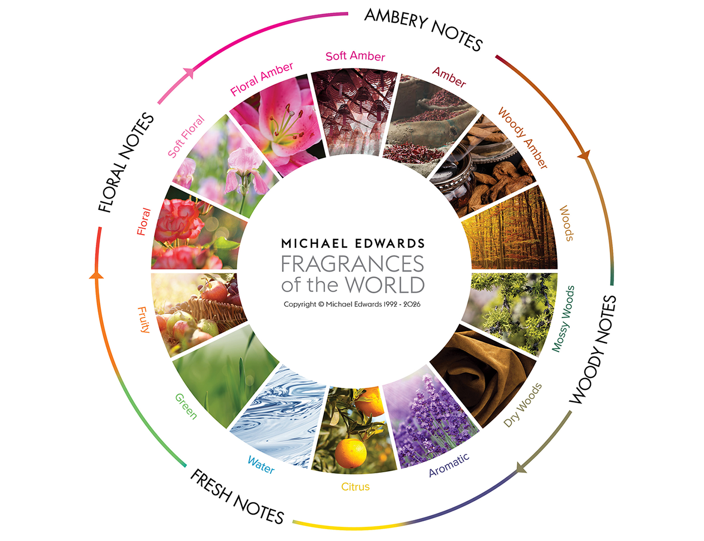

# Roda de Fragrâncias

A história dos perfumes remonta à própria história da humanidade. Mas a partir do final do século 19, com o início do uso das moléculas sintéticas, do Fougère Royale, o Chanel N.5 no início do século 20, a escalada do luxo e popularização do pós-guerra, o perfume deixa de ser apenas floral, aromático e unissex, para ter uma multitude de variedades, nuances e facetas que competem em complexidade com os bons vinhos.

Nesse contexto, coube ao taxonomista e historiador Michael Edwards iniciar um extenso e longevo trabalho de classificação de fragrâncias, de modo que o mundo pudesse falar uma mesma língua ao debater sobre fragrâncias. Esse trabalho recebe uma publicação hoje chamada “Fragrances of the World”, utilizada para registrar e classificar fragrâncias, muitas vezes com ajuda do próprio criador, e é também um guia para descobrir similaridades. A base da classificação do catálogo é a Roda de Fragrâncias.

Em sua versão mais recente, divide as fragrâncias em 4 famílias principais: 

Floral, Âmbar  (Oriental), Madeira e Fresco.

Cada uma dessas famílias divide-se em algumas sub-categorias

| Famílias | Subfamílias | Exemplos |
| --- | --- | --- |
| Floral | Floral | Flores recém-cortadas; flores |
|  | Floral Suave | Aldeídos; notas atalcadas |
|  | Floral Âmbar | Flor de laranjeira; especiarias doces |
| Âmbar (antes “Oriental”) | Âmbar Suave | Incenso; âmbar |
|  | Âmbar | Oriental; resinas |
|  | Âmbar Amadeirado | Sândalo; Patchouli |
| Amadeirado | Madeiras | Madeiras aromáticas; vetiver |
|  | Madeiras Musgosas | Musgo de carvalho; âmbar |
|  | Madeiras Secas | Madeiras secas; couro |
| Fresco | **Aromático** | Lavanda; ervas aromáticas |
|  | Cítrico | Bergamota; óleos cítricos |
|  | Aquático | Marinho; notas aquáticas |
|  | Verde | Gálbano; notas verdes |
|  | Frutado | Frutas vermelhas; frutas |

## Floral

Provavelmente a mais antiga, natural e ampla família. Em aroma individual ou combinado em bouquet, normalmente utilizada em notas de topo ou coração. Expressam suavidade, intimidade, emoção.

Podem ser obtidas naturalmente de maneira facil como Rosas e Jasmin ou em pequenas quantidades, extraídas a alto custo, como lírio e violeta. Estas acabam recriadas em moléculas sintéticas nas fragrâncias de produção em massa. A grande quantidade de variações sintéticas de uma mesma flor (Rosa, Rosa damascena, Rosa turca, Rosa Vermelha, Rosa recém desabrochada, Pétalas de rosa seca) demonstra a amplitude e fascínio desta imensa família.

Possui três sub-grupos: 

- Floral;
- Floral Suave;
- Floral Âmbar.

## Âmbar (Oriental)

A família mais marcante. Calor, riqueza e difusão, contribuem com longa duração, intimidade, impacto e memória olfativa, formando uma assinatura marcante. Mais pesadas, normalmente compõe as notas de corpo ou fundo.

Fazem parte desta família: Baunilha, resinas. âmbar, especiarias e almíscar animal.

Possui três sub-grupos: 

- Âmbar suave;
- Âmbar;
- Âmbar amadeirado.

## Amadeirado

Madeiras contribuem para elegância, profundidade, estabilidade e longevidade. Tipicamente formam a base ou fundo das fragrâncias. São elas que definem a percepção de desempenho da fragrância.

Possui três sub-grupos: 

- Madeiras;
- Madeiras Musgosas;
- Madeiras secas.

## Frescos

A Família mais “leve”, extemamente voláteis e de impacto imediato. Fresco, leve, enérgico, luminoso. Esses predicados normalmente vêm desta família. Agrega os aromáticos, cítricos, frutais, aquosos, verdes. Muito apreciados em climas quentes com o brasileiro e frequentemente associados à vida ativa, agitada e esportiva.

- Aromático;
- Cítrico;
- Aquático;
- Verde;
- Frutado.

## (Aromatic) Fougère

Antes de 2010, a roda de fragrâncias trazia como família central os Fougère (Referência ao Fougère Royale, perfume histórico), com um acorde típico (Cumarina e Lavanda, combinado outras notas) que basicamente caracteriza o que conhecemos como “masculino, classico, suave, limpo”.

## Chypre

Assim como os Fougère, não são exatamente uma família da Roda de Fragrâncias, mas um acorde que não se consegue delimitar facilmente e não se pode deixar de citar. Assim como os Fougère, tem a origem do nome em uma fragrância específica (Chypre de Francois Coty), que caracterizava-se por uma tríade Citrico-Labdanum-Musgo. Aqui, ao contrário dos Fougère, destacam-se pela complexidade, múltiplas camadas, que continuam evoluindo ao longo de muitas horas.

[Pirâmide Olfativa](./202611-07-Piramide_Olfativa.md)

[Concentração de Perfumes](./202611-07-Concentracao_de_Perfumes.md)

[Famílias Olfativas e Acordes](./202611-07-Familias_Olfativas_e_Acordes.md)

[Perfil Masculino e Perfil Feminino na escolha de perfumes](./202611-07-Perfil_Masculino_e_Perfil_Feminino_na_escolha.md)