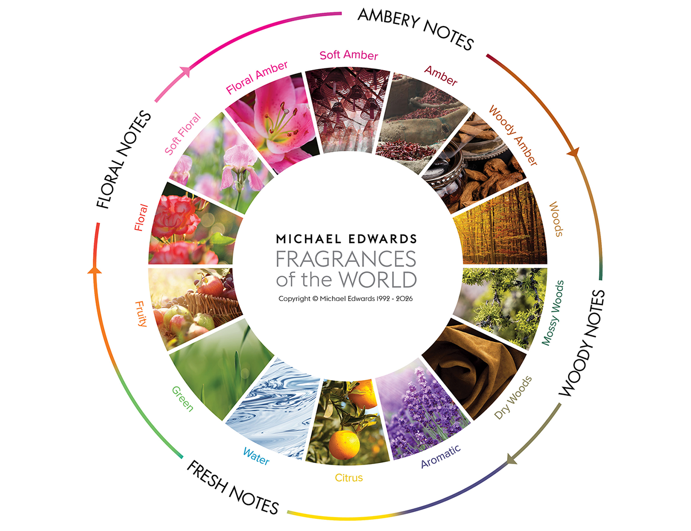

A história moderna da alta perfumaria demandou uma linguagem universal. Coube ao historiador e taxonomista britânico **Michael Edwards** desenvolver o mapa de classificação mais adotado no mundo: a **Roda de Fragrâncias** (*Fragrance Wheel*).

Publicada anualmente no clássico *“Fragrances of the World”*, ela orienta perfumistas, colecionadores e casas de fragrâncias de Grasse, Paris e Nova York.

A Roda organiza todo o espectro olfativo em **4 Famílias Principais** e **14 Subfamílias**:

### 1. Família Floral
A mais clássica e feminina das famílias. Expressa elegância, romantismo e frescor.
* **Floral:** Rosa, Jasmim, Lírio recém-colhido.
* **Floral Suave:** Aldeídos luminosos e notas atalcadas.
* **Floral Âmbar:** Flor de laranjeira combinada com especiarias doces.

### 2. Família Âmbar (Oriental)
Calorosa, rica e inebriante. Proporciona longa duração e sensualidade.
* **Âmbar Suave:** Incenso balsâmico e resinas amenas.
* **Âmbar Clássico:** Baunilha de Bourbon, fava tonka e mirra.
* **Âmbar Amadeirado:** Sândalo cremoso e patchouli.

### 3. Família Amadeirada
Estrutural, viril, nobre e persistente.
* **Madeiras Clássicas:** Cedro da Virgínia, Vetiver, Sândalo.
* **Madeiras Musgosas (Chypre):** Musgo de carvalho e acordes terrosos.
* **Madeiras Secas:** Couro nobre, tabaco e notas defumadas.

### 4. Família Fresca
Energia, luminosidade e vivacidade, ideal para o clima tropical brasileiro.
* **Aromático:** Lavanda francesa, alecrim e ervas finas.
* **Cítrico:** Bergamota da Calábria, mandarina e limão siciliano.
* **Aquático:** Notas ozônicas e brisa marinha.
* **Verde:** Gálbano e folhas orvalhadas.
* **Frutado:** Pêssego, maçã verde e bagas vermelhas.
